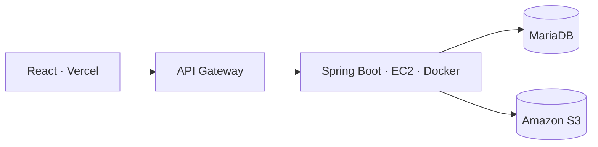

# MusicRights API

API REST de **MusicRights**, una aplicación que ayuda a los músicos independientes a reclamar sus derechos de autor ante la SGAE.

Cada concierto en el que un músico interpreta obras propias genera derechos que puede reclamar, pero el trámite exige rellenar a mano un formulario oficial de 76 campos por actuación, y el derecho caduca a los cinco años. Esta API centraliza obras, conciertos y músicos, **genera automáticamente el PDF oficial de la SGAE ya cumplimentado** y lo guarda en Amazon S3.

> Frontend: [MusicRights-web](https://github.com/AritzOntal/MusicRights-web) · App Android: [MusicRightsApp](https://github.com/AritzOntal/MusicRightsApp)

---

## Arquitectura



- **API Gateway** es el único punto de entrada público y hace de proxy hacia la API.
- La **API y MariaDB** corren como contenedores en una instancia **EC2**, comunicados por una red interna de Docker.
- Los PDF se guardan en **S3** y se descargan mediante **URLs prefirmadas** temporales, sin exponer el bucket.

---

## Funcionalidades

- Registro de músicos, obras (con validación del código ISRC) y conciertos.
- **Generación del formulario oficial de la SGAE** con Apache PDFBox sobre la plantilla AcroForm real, con cálculo del porcentaje de completitud.
- Almacenamiento de documentos en S3 y descarga mediante URL prefirmada.
- Borrado en cascada: al eliminar un concierto se eliminan sus documentos, tanto en la base de datos como en S3.
- Autenticación con **JWT** y autorización por roles (`USER`, `MUSICIAN`, `ADMIN`).

---

## Stack

| Capa | Tecnología |
|---|---|
| Lenguaje y framework | Java 21, Spring Boot 3.2.5 |
| Seguridad | Spring Security, JWT (jjwt), arquitectura sin estado |
| Persistencia | MariaDB 11.3, Spring Data JPA / Hibernate, consultas JPQL |
| Documentos | Apache PDFBox 3 |
| Cloud | AWS EC2, API Gateway, S3 (AWS SDK v2) |
| Contenedores | Docker, Docker Compose, Docker Hub |
| Pruebas de API | Colección de Postman ejecutada con Newman en GitHub Actions |
| Documentación y mocks | OpenAPI 3.0 (`MusicRights.yaml`), WireMock |

---

## Diseño del backend

Arquitectura en tres capas:

- **Controllers** (`@RestController`): reciben la petición y delegan en los servicios.
- **Services** (`@Service`): lógica de negocio, transacciones y servicios externos (`S3StorageService`, `SgaePdfService`).
- **Repositories** (`JpaRepository`): CRUD y consultas personalizadas con `@Query`.

Además:

- **DTOs** de entrada y salida para no exponer datos sensibles ni provocar ciclos de serialización.
- **Validación** declarativa con Jakarta Validation (`@Pattern`, `@Positive`, `@PastOrPresent`…).
- **Gestión global de errores** con `@RestControllerAdvice`, que devuelve respuestas HTTP uniformes.

---

## Seguridad

| Recurso | Acceso |
|---|---|
| `POST /api/auth/login`, `POST /api/v1/users` | Público |
| `GET` obras y músicos | Cualquier usuario autenticado |
| Crear, editar y borrar obras, conciertos y reclamaciones | `MUSICIAN`, `ADMIN` |
| Documentos propios y descarga prefirmada | `MUSICIAN`, `ADMIN` |
| Administración de usuarios | `ADMIN` |

Las credenciales de AWS **no están en el código**: el SDK las resuelve desde variables de entorno.

---

## Endpoints principales

| Método | Ruta | Descripción |
|---|---|---|
| POST | `/api/auth/login` | Login, devuelve el JWT |
| POST | `/api/v1/users` | Registro de usuario |
| POST | `/api/v1/musicians/me` | Alta como músico del usuario autenticado |
| GET / POST | `/api/v1/concerts` | Conciertos del músico / crear concierto |
| POST | `/api/v1/concerts/{id}/sgae-document` | Genera el PDF de la SGAE y lo sube a S3 |
| GET | `/api/v1/documents/mine` | Documentos del músico |
| GET | `/api/v1/documents/{id}/download` | URL prefirmada de descarga |
| DELETE | `/api/v1/documents/mine/{id}` | Borra el documento y su objeto en S3 |

La especificación completa está en `MusicRights.yaml` (OpenAPI 3.0).

---

## Ejecución en local

```bash
# 1. Copiar las variables de entorno y rellenarlas
cp .env.sample .env

# 2. Levantar la base de datos
docker compose -f docker-compose.dev.yaml up -d

# 3. Arrancar la API
mvn spring-boot:run
```

Para desarrollar el frontend sin backend, hay un servidor de mocks con WireMock:

```bash
java -jar wiremock-standalone-3.13.2.jar --port 8081 --verbose
```

---

## Despliegue

1. Compilación con Maven y construcción de la imagen Docker para `amd64`.
2. Publicación de la imagen en Docker Hub.
3. En la instancia EC2, `docker compose up -d` recrea el contenedor con la nueva versión junto a MariaDB (con *healthcheck* y volumen persistente).
4. API Gateway enruta el tráfico público hacia la instancia.

En cada *push* a `develop`, **GitHub Actions** ejecuta la colección de Postman con **Newman** para validar la API.

---

## Mejoras previstas

- Avisos de caducidad desde el backend (correo o tareas programadas).
- Alta disponibilidad con varias instancias detrás de un balanceador.
- Despliegue en una región europea para producción real.

---

Proyecto final del CFGS de Desarrollo de Aplicaciones Multiplataforma (Centro San Valero, 2026).

**Autor:** Aritz Ontalvilla
